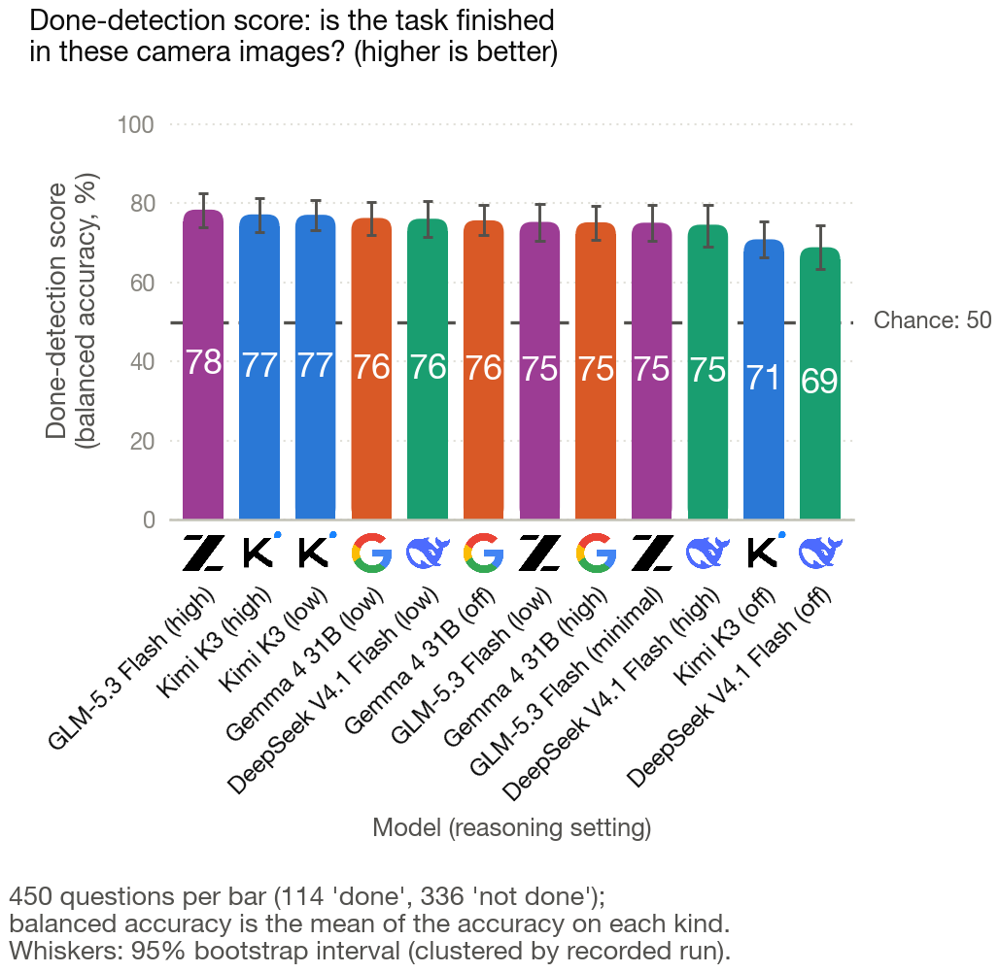
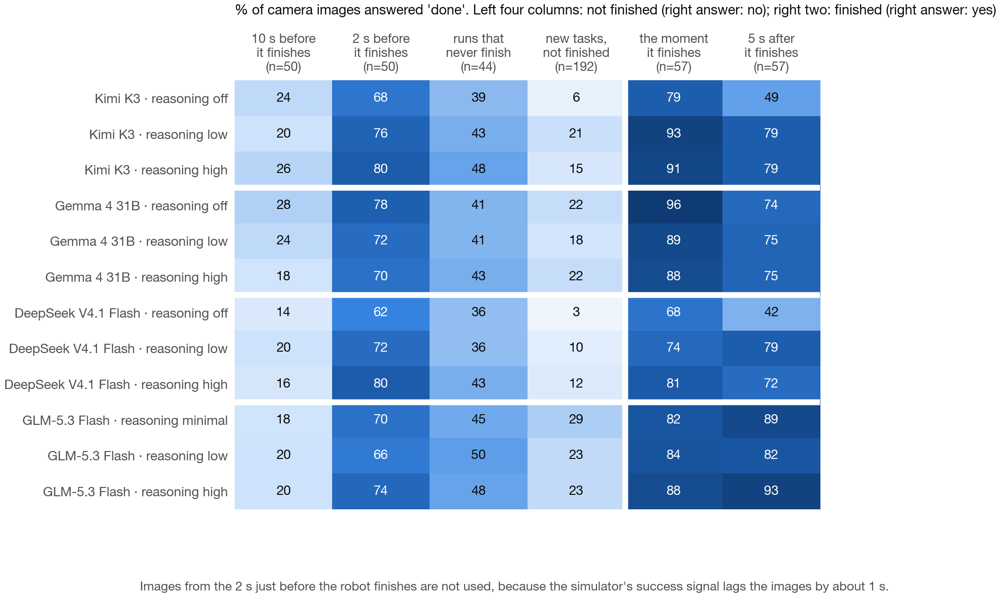
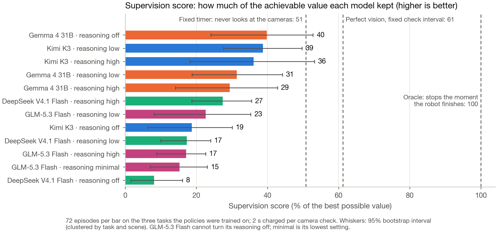
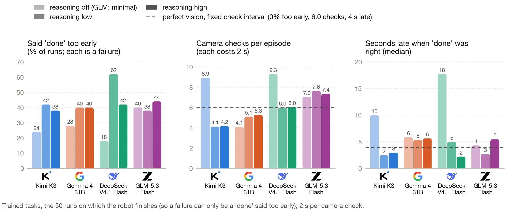
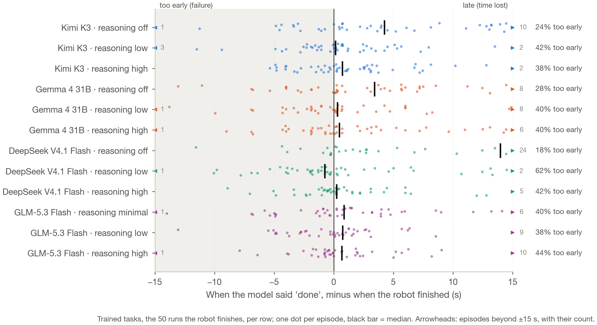

# Replay benchmark: done-detection and look scheduling with four open models

W1 (Tom Wang), October 26, 2026. Every decision below is taken from the design record
(`docs/superpowers/specs/2026-10-24-replay-benchmark-design.md`), with the reason given there and the time it was
fixed. Numbers come from `results/w1/replay/summary.json` (`scripts/replay_analyze.py`) and
`results/w1/replay/losses.json` (`scripts/replay_losses.py`); figures from `scripts/replay_figures.py`. The 4-page
class report is `docs/cos597c_report/report.pdf`; this file is the full technical record behind it.

**Glossary (this record's terms, and the class report's plain names).**

| Here | In the class report | Meaning |
|---|---|---|
| probe | done-detection test | 450 single "is the task finished?" questions, no history |
| sessions | supervision test | the model supervises a recorded run: wait N steps or say "done", 2 s per look |
| look | camera check | one model call during an episode |
| leave-alone tasks | trained tasks | OpenCabinet, PickPlaceCounterToStove, CloseFridge (the policies were trained on them) |
| unseen tasks | new tasks | the four composite tasks the robot rarely finishes |
| perfect detector | perfect vision, fixed check interval | knows when the task is finished, checks every k steps (k tuned in other scenes) |
| fixed timer | fixed timer | never looks; declares "done" after T steps (T tuned in other scenes) |
| oracle | oracle | declares at the exact step the robot first succeeds |
| none (`off`; GLM `minimal`) | reasoning off (GLM: minimal) | the lowest reasoning setting the provider accepts |
| supervision score | supervision score | the model's value as % of the oracle's on the leave-alone tasks (added October 26) |

## Summary

- **Headline (supervision score, % of the oracle's value, leave-alone tasks).** Best: Gemma 4 31B with reasoning off
  39.8 [24.1, 52.8] and Kimi K3 low 38.7 [27.7, 49.7]; worst: DeepSeek V4.1 Flash off 8.1 [1.6, 16.1]. Reference:
  perfect detector 61.2, fixed timer 50.8. Paired on the same runs, all 12 configurations are below the perfect detector
  and 11 below the timer (Kimi K3 high is not distinguishable from it).

- **Question.** Two supervisor skills, measured separately: (1) *done-detection*, telling from the cameras whether the
  robot has finished; (2) *look scheduling*, choosing how long to let a policy run before looking again.
- **Method.** 168 recorded robot runs are replayed to four open models served by Sail Research (Kimi K3, Gemma 4 31B,
  DeepSeek V4.1 Flash, GLM-5.3 Flash), each at three requested reasoning levels: none (GLM: `minimal`), low, high.
  Probe: 450 single "is it done?" questions per model and level. Sessions: 168 supervised episodes per model and level.
- **Done-detection.** Balanced accuracy is 0.69-0.78 in every cell. Turning reasoning on helps Kimi (+0.064 high − none,
  95% CI [+0.013, +0.114]) and DeepSeek (+0.058 [+0.006, +0.109]); it does not measurably help Gemma (−0.006
  [−0.039, +0.026]) or GLM (+0.032 [−0.007, +0.072]). `low` and `high` do not differ for any model. Every model says
  "done" 62-80% of the time 2 s before the robot succeeds, and 36-50% of the time on runs that never succeed.
- **Look scheduling.** No model at any level reaches the perfect-perception detector with a fixed look interval (the
  primary measure; every 95% CI for value minus detector lies below 0, see the session table). Most also lose to a
  fixed timer. Without reasoning, Kimi and DeepSeek look about twice as often and are more often right when they
  declare, but finish later; with reasoning they look less but declare a few seconds too early on 38-62% of the runs
  that do succeed.
- **The requested level is not always a change in reasoning.** GLM `low` is indistinguishable from `minimal` (7 output
  tokens, no thinking, on all 450 probes), and Gemma and DeepSeek think the same amount at `low` and `high`. Levels are
  compared within a model only.
- **Spend:** an estimated $138.71 of the $150 cap for everything run since October 24 (the raw ledger, which books
  every timed-out request at its worst case, says $163.03). The grid itself cost an estimated $71.9.
- **Losses:** 34 probe replies and 9 session replies were paid for and never saved; 181 grid episodes were interrupted
  and replayed from their start (1,402 looks paid twice, $1.91); requests in flight when a process stopped are not
  recoverable and cannot be counted for the probe. Details in "What went wrong" and "What was lost".

## 1. Question, and why replay

The October 15-16 live runs mixed three skills (re-prompting, done-detection, look scheduling) into one time-charged
regret and could measure only one of them (`docs/reanalysis.md`). Tom narrowed the question on October 23-24 to two
skills. Re-prompting was dropped because these policies do not respond to better instructions: in the stage 6 ceiling
test, a privileged prompter that reads the simulator's state and gives correct step-by-step instructions solved 3 of
76 paired unseen-task episodes, against 4 of 76 for the plain policy (`docs/stage6_ceiling.md`). Only restraint could
be measured. Opus and Sonnet were dropped; only open-weight models are
evaluated.

**Why replay.** Without re-prompting, the supervisor's only actions are "let it run N more steps" and "done". Neither
changes what the robot does, so a recorded uninterrupted run contains everything a live run would. Consequences: every
model sees the identical trajectory (no robot noise between models), conditions can be repeated, and nothing needs a
GPU. Fresh recordings were rejected for the deadline (pod setup, a logging change and a new release would not fit).

## 2. Data

- **Trajectories:** the always-defer runs of pod C (`runs/addon/podC/always_defer`, 84) and pod B
  (`runs/final/podB/always_defer`, 84): 168 runs, of which 57 reach the task checker's success. Three policies
  (`groot`, `groot_u30`, `pi05`), seven tasks (three leave-alone: OpenCabinet, PickPlaceCounterToStove, CloseFridge;
  four unseen composite tasks), four scenes (1000-1003). Pod A's videos sit in a bucket this machine cannot read.
  Scene 1003 is usable here; its earlier exclusion came from pairing live sessions with twins, which replay does not
  need.
- **Frames:** three 256 × 256 cameras, one frame every 10 steps plus the final step. *Limitation:* images only (joint
  readings were not logged densely); looks land on multiples of 10 steps.
- **Labels** come from the recorded checker, never shown to a model.

## 3. Models and reasoning levels

**Models.** Kimi K3, Gemma 4 31B, DeepSeek V4.1 Flash 1017 and GLM-5.3 Flash are the four models Sail serves with image
input in its synchronous API (probed October 24-25; DeepSeek V4.1 Flash was found on October 25 because the first
probe tested only two of Sail's four DeepSeek models). Qwen3.6 is served only in an asynchronous mode; the other
DeepSeek V4 models, GLM-5.3, gpt-oss-120b and Gemma 4 12B take no images. Sail serves quantized weights; results are
for those.

**Grid (Tom, October 25, 21:30; confirmed 21:50).** Every model is run at the same three requested levels, in the probe
and in the sessions: `none` (thinking disabled), `low`, `high`. GLM uses `minimal` for none, because Sail rejects
disabling its reasoning; it is labelled "none (minimal)" throughout. *Reason:* one grid for every model; whether a
provider's levels differ is itself a result. `medium` was considered and dropped (all four models accept it, but it
would have finished around midday on October 26 for about $147); `xhigh` was not asked for. Their partial runs stay on
disk and are not used.

**Settings, identical for every cell.** Reply limit 32,768 tokens (so that higher levels are not penalised for being
cut off); per-call time limit 900 s with up to 4 attempts (a 180 s limit timed out 5-8% of DeepSeek's attempts and
stalled GLM's sessions on October 24); one idempotency key per call; every call records the requested level, Sail's
`stop_reason`, the thinking-block length, output tokens and attempts (the manipulation check).

**Within-model comparisons only.** Sail maps a requested level onto each model's own tiers, so "high" on one model is
not the same amount of reasoning as "high" on another. Figures place models side by side, but contrasts are computed
within a model.

**Manipulation check.** Did the requested level change the reasoning? Medians over the 450 probes:

| Model | Level | Median output tokens | Median thinking chars | Median s/call | Cut off | Unreadable |
|---|---|---|---|---|---|---|
| Kimi K3 | none | 12 | 0 | 27.9 | 0 | 0 |
| Kimi K3 | low | 92 | 343 | 29.3 | 0 | 0 |
| Kimi K3 | high | 361 | 1,576 | 29.8 | 0 | 0 |
| Gemma 4 31B | none | 6 | 0 | 25.5 | 0 | 0 |
| Gemma 4 31B | low | 226.5 | 838.5 | 13.8 | 0 | 0 |
| Gemma 4 31B | high | 230 | 844.5 | 8.0 | 0 | 0 |
| DeepSeek V4.1 Flash | none | 6 | 0 | 29.1 | 0 | 0 |
| DeepSeek V4.1 Flash | low | 373 | 1,555.5 | 23.7 | 0 | 0 |
| DeepSeek V4.1 Flash | high | 370 | 1,630 | 13.9 | 0 | 0 |
| GLM-5.3 Flash | none (minimal) | 7 | 0 | 31.0 | 0 | 0 |
| GLM-5.3 Flash | low | 7 | 0 | 3.9 | 0 | 0 |
| GLM-5.3 Flash | high | 53 | 206 | 4.1 | 0 | 0 |

- Only Kimi has three distinct levels. Gemma and DeepSeek have two in practice (none, and the same amount of thinking
  at low and high). GLM's `low` returns no thinking, exactly like `minimal`; only `high` reasons, briefly.
- No reply in the grid was cut off at 32,768 tokens, and no probe reply was unreadable.
- Seconds per call measure Sail's serving load at the time, not the model; they are not part of any score.

## 4. Measures and baselines (fixed before any model call)

**Probe (skill 1 alone).** One call per probe, no history: the task instruction and three images (all three cameras
now, 2 s earlier and 5 s earlier, each set tiled into one image, under GLM's 4-image limit). The model answers
`{"done": true|false}`.

- *Labels:* positive at the checker's first true frame and 5 s later; negative 2 s and 10 s before the first true
  step, and at the middle and end of runs that never succeed (fixed seed): 114 positives and 336 negatives.
  Frames in the 2 s before success are not probed, because the checker lags visible completion by about 20 steps
  (stage 3); the 40-step band is twice that lag.
- *Primary:* balanced accuracy (the mean of the hit rate on positives and the correct-rejection rate on negatives),
  because positives come almost only from the three leave-alone tasks and plain accuracy would reward saying "not
  done". 95% bootstrap clustered by recorded run (4,000 draws). Unreadable replies count as wrong. Level contrasts are
  paired on identical probes.

**Sessions (skills 1 and 2 together).** One session per (pod, scene): eight sessions of 21 episodes in the frozen plan
order (task blocks, anonymous policy letters). At step 0 the model sees the task and the first frame and replies
`{"op": "wait", "steps": N}` (10-400, rounded to 10) or `{"op": "done"}`. At each look it sees the cameras now and at two
earlier points of the interval, the step, the time left, the cost per look and its earlier looks. "Done" is scored by
the checker at that step; reaching the step budget is a failure. An unreadable reply is asked again and costs a look.

- *Experience:* before each episode the model sees one line per earlier episode of the session (policy letter, task,
  outcome, when it declared, looks). This is the logged past-outcome exception (`docs/decisions.md`, 2026-10-13);
  adaptation to anonymous policies is impossible without it. Nothing about the current episode's checker is shown.
- *Score:* value = success × max(0, 1 − (robot seconds + looks × c) / deadline), deadline = the task's step budget,
  c = 2 s per look for every model (not each model's latency, which on Sail measures serving speed).
- *Baselines (no LLM), tuned on the same policy and task in the other scenes:* a fixed timer (a look at step 0 and the
  declaration); a perfect detector that looks every k steps and declares at the first true look (the bar for
  scheduling); and the oracle (declare at the first success with one look). They pay looks exactly like a model.
- *Primary:* on the three leave-alone tasks, value minus the held-out perfect detector on the same recorded run, 95%
  bootstrap clustered by (task, scene). Everything else is descriptive. Adaptation (exploratory, low power) is checked
  within task blocks: for two policies supervised on the same task in a session, is the one that usually finishes
  later given the longer first wait or the later declaration?

## 5. Results: done-detection (probe)



| Model | Level | n | Balanced accuracy [95% CI] | Hit rate (done) | Correct rejection (not done) |
|---|---|---|---|---|---|
| Kimi K3 | none | 450 | 0.709 [0.664, 0.755] | 0.640 | 0.777 |
| Kimi K3 | low | 450 | 0.771 [0.733, 0.809] | 0.860 | 0.682 |
| Kimi K3 | high | 450 | 0.772 [0.727, 0.814] | 0.851 | 0.693 |
| Gemma 4 31B | none | 450 | 0.757 [0.719, 0.797] | 0.851 | 0.664 |
| Gemma 4 31B | low | 450 | 0.763 [0.721, 0.804] | 0.825 | 0.702 |
| Gemma 4 31B | high | 450 | 0.752 [0.708, 0.793] | 0.816 | 0.688 |
| DeepSeek V4.1 Flash | none | 450 | 0.689 [0.633, 0.744] | 0.553 | 0.824 |
| DeepSeek V4.1 Flash | low | 450 | 0.761 [0.716, 0.805] | 0.763 | 0.759 |
| DeepSeek V4.1 Flash | high | 450 | 0.746 [0.691, 0.797] | 0.763 | 0.729 |
| GLM-5.3 Flash | none (minimal) | 450 | 0.751 [0.705, 0.796] | 0.860 | 0.643 |
| GLM-5.3 Flash | low | 450 | 0.753 [0.704, 0.799] | 0.833 | 0.673 |
| GLM-5.3 Flash | high | 450 | 0.784 [0.739, 0.826] | 0.904 | 0.664 |

Paired contrasts within each model (same 450 probes, 95% CI clustered by recorded run):

| Model | low − none | high − none | high − low |
|---|---|---|---|
| Kimi K3 | +0.062 [+0.006, +0.117] | +0.064 [+0.013, +0.114] | +0.002 [−0.039, +0.044] |
| Gemma 4 31B | +0.006 [−0.022, +0.033] | −0.006 [−0.039, +0.026] | −0.012 [−0.040, +0.018] |
| DeepSeek V4.1 Flash | +0.073 [+0.021, +0.127] | +0.058 [+0.006, +0.109] | −0.015 [−0.064, +0.031] |
| GLM-5.3 Flash | +0.002 [−0.043, +0.044] | +0.032 [−0.007, +0.072] | +0.031 [−0.010, +0.075] |

- For Kimi and DeepSeek, reasoning makes the model say "done" more readily: the hit rate rises (Kimi 0.64 → 0.85-0.86,
  DeepSeek 0.55 → 0.76) more than the correct-rejection rate falls. The net gain is about +0.06 to +0.07 balanced
  accuracy, the same at low and high.
- Gemma does not change with the level, although its thinking does (0 → about 840 characters). GLM's only reasoning
  level, `high`, is +0.03 with an interval that includes 0.
- Twelve cells cannot rank models: the intervals of the best and worst cells overlap, and levels are not comparable
  across models.



Where the errors are: every model says "done" on 62-80% of frames 2 s before success (the robot is visibly almost
finished), 14-28% at 10 s before, 36-50% on frames of leave-alone runs that never succeed, and 3-29% on unseen-task
frames. At success it says "done" 68-96% of the time. The 2 s-before errors are partly a property of the label: the
checker turns true about 1 s after the images look finished, so some of these "errors" may be correct readings of the
image.

## 6. Results: look scheduling (sessions)





Leave-alone tasks, 2 s per look, 72 episodes per cell (50 on runs the robot finishes). Baselines on the same runs:
perfect detector 0.173, timer 0.144, oracle 0.284.

<!-- session-table -->
| Model | Level | Episodes | Value [95% CI] | Value − detector [95% CI] | Value − timer [95% CI] | Looks / episode | Correct on runs that succeed | False "done" | Median lag (s) | Median s early |
|---|---|---|---|---|---|---|---|---|---|---|
| Kimi K3 | none | 72 | 0.053 [0.014, 0.099] | −0.121 [−0.167, −0.077] | −0.091 [−0.150, −0.030] | 10.03 | 0.760 | 34 | 10.0 | 3.4 |
| Kimi K3 | low | 72 | 0.110 [0.066, 0.160] | −0.064 [−0.118, −0.012] | −0.034 [−0.066, −0.003] | 4.60 | 0.580 | 43 | 2.5 | 2.3 |
| Kimi K3 | high | 72 | 0.102 [0.044, 0.171] | −0.071 [−0.139, −0.023] | −0.042 [−0.083, +0.002] | 4.42 | 0.620 | 41 | 3.0 | 2.8 |
| Gemma 4 31B | none | 72 | 0.113 [0.056, 0.173] | −0.061 [−0.097, −0.028] | −0.031 [−0.048, −0.012] | 4.26 | 0.720 | 36 | 5.9 | 4.0 |
| Gemma 4 31B | low | 72 | 0.089 [0.043, 0.143] | −0.085 [−0.141, −0.032] | −0.055 [−0.097, −0.016] | 5.46 | 0.600 | 42 | 5.4 | 2.6 |
| Gemma 4 31B | high | 72 | 0.083 [0.034, 0.137] | −0.090 [−0.125, −0.057] | −0.061 [−0.099, −0.021] | 5.43 | 0.600 | 42 | 5.6 | 1.9 |
| DeepSeek V4.1 Flash | none | 72 | 0.023 [0.004, 0.047] | −0.151 [−0.221, −0.084] | −0.121 [−0.185, −0.062] | 9.31 | 0.820 | 31 | 17.7 | 0.9 |
| DeepSeek V4.1 Flash | low | 72 | 0.049 [0.025, 0.075] | −0.125 [−0.182, −0.070] | −0.095 [−0.148, −0.041] | 6.96 | 0.380 | 53 | 5.0 | 2.0 |
| DeepSeek V4.1 Flash | high | 72 | 0.078 [0.045, 0.114] | −0.096 [−0.155, −0.043] | −0.066 [−0.109, −0.024] | 6.64 | 0.580 | 43 | 2.2 | 1.0 |
| GLM-5.3 Flash | none (minimal) | 72 | 0.043 [0.016, 0.075] | −0.130 [−0.197, −0.066] | −0.101 [−0.172, −0.036] | 7.67 | 0.600 | 42 | 4.3 | 3.8 |
| GLM-5.3 Flash | low | 72 | 0.064 [0.019, 0.113] | −0.109 [−0.166, −0.058] | −0.080 [−0.146, −0.012] | 8.26 | 0.620 | 41 | 2.7 | 2.8 |
| GLM-5.3 Flash | high | 72 | 0.049 [0.019, 0.077] | −0.125 [−0.183, −0.065] | −0.095 [−0.152, −0.038] | 7.88 | 0.560 | 44 | 5.5 | 0.8 |
<!-- /session-table -->

"Lag": seconds from the robot's first success to a correct declaration. "s early": seconds before the first success
for a premature declaration on a run that does succeed. No episode ran out of budget on a run that succeeds (0 missed
"done" in every cell).

- **Primary measure:** every cell is below the perfect detector, with 95% intervals excluding 0. The best cells (Gemma
  none, Kimi low) lose about 0.06 value, about a third of what the detector earns.
- **Below the timer too:** almost every cell also loses to a timer tuned in other scenes; Kimi high's interval just
  reaches 0.
- **The trade-off reasoning changes:** without reasoning, Kimi and DeepSeek look about twice as often (9-10 looks per
  episode against 4-7) and are right more often when they declare (0.76-0.82 of runs that succeed against 0.38-0.62),
  but each look costs 2 s and they declare late (median 10-18 s after success), so value is lower. With reasoning they
  look less and declare sooner, but declare too early on 38-62% of the runs that do succeed.
- **Runs that never succeed (22 of 72):** every cell declares "done" on every one of them (22/22). These episodes score
  0 whether the model declares or lets the budget run out, so the value measure does not distinguish the two; false
  "done" counts above include them.



**All tasks and unseen tasks.** On the four unseen composite tasks, 7 of 96 runs succeed; every cell declares "done"
on 88-89 of the 89 failing runs, and value there is 0.000-0.008. Unseen tasks therefore add almost nothing to the
comparison; they are reported for completeness.

<!-- all-table -->
| Model | Level | Episodes | Value, all tasks [95% CI] | Value, unseen [95% CI] | Looks / episode, unseen | Complete sessions |
|---|---|---|---|---|---|---|
| Kimi K3 | none | 168 | 0.025 [0.006, 0.048] | 0.005 [0.000, 0.014] | 26.01 | 8/8 |
| Kimi K3 | low | 168 | 0.051 [0.025, 0.082] | 0.008 [0.000, 0.023] | 14.80 | 8/8 |
| Kimi K3 | high | 168 | 0.045 [0.016, 0.080] | 0.002 [0.000, 0.007] | 12.42 | 8/8 |
| Gemma 4 31B | none | 168 | 0.048 [0.018, 0.083] | 0.000 [0.000, 0.000] | 13.99 | 8/8 |
| Gemma 4 31B | low | 168 | 0.038 [0.014, 0.067] | 0.000 [0.000, 0.000] | 16.62 | 8/8 |
| Gemma 4 31B | high | 168 | 0.036 [0.011, 0.065] | 0.000 [0.000, 0.000] | 16.82 | 8/8 |
| DeepSeek V4.1 Flash | none | 168 | 0.011 [0.002, 0.022] | 0.002 [0.000, 0.006] | 23.34 | 8/8 |
| DeepSeek V4.1 Flash | low | 168 | 0.021 [0.008, 0.036] | 0.000 [0.000, 0.000] | 16.38 | 8/8 |
| DeepSeek V4.1 Flash | high | 168 | 0.035 [0.016, 0.057] | 0.003 [0.000, 0.007] | 15.75 | 8/8 |
| GLM-5.3 Flash | none (minimal) | 168 | 0.019 [0.005, 0.035] | 0.000 [0.000, 0.000] | 24.86 | 8/8 |
| GLM-5.3 Flash | low | 168 | 0.028 [0.007, 0.052] | 0.000 [0.000, 0.000] | 29.98 | 8/8 |
| GLM-5.3 Flash | high | 168 | 0.021 [0.006, 0.037] | 0.000 [0.000, 0.000] | 24.23 | 8/8 |
<!-- /all-table -->

**Adaptation (exploratory).** If a model adapted to each anonymous policy's speed, the policy that usually finishes
later would get the longer first wait and the later declaration: a concordant share above 0.5.

- *First wait:* shares 0.27-0.69. Only Gemma none is above 0.5 (0.69 [0.56, 0.81]), from only 16 untied pairs: Gemma
  gives every policy the same first wait in most blocks (48 of 64 pairs tied).
- *Declaration step:* shares 0.37-0.58. The intervals of DeepSeek low (0.37 [0.27, 0.47]) and of all
  three GLM levels (0.38-0.43, upper bounds 0.48-0.49) lie *below* 0.5: the policy that usually finishes later was
  declared earlier. The likely reason is not scheduling but failure: slower policies fail more often, and every model
  declares "done" on failing runs early. This is a reading of the pattern, not a tested explanation.
- There is no evidence that any model adapts its schedule to the policies' speeds. The test has little power (64 policy
  pairs per cell, many tied). Per-cell values are in `summary.json` (`adaptation_within_blocks`).

## 7. Reasoning-level effects within each model

- **Kimi K3:** reasoning helps detection (+0.06) and session value (none 0.053 → low 0.110, high 0.102) by cutting
  looks from 10 to under 5. `low` and `high` do not differ although `high` thinks 4.6 times as much.
- **Gemma 4 31B:** no detectable effect on detection; session value is highest without reasoning (0.113 against
  0.083-0.089), with overlapping intervals. `low` and `high` produce the same thinking.
- **DeepSeek V4.1 Flash:** reasoning helps detection (+0.06 to +0.07); in sessions, `none` looks most and declares
  late, `low` declares too early on 62% of runs that succeed, and `high` sits between them (6.6 looks, 42% early,
  value minus detector −0.096 [−0.155, −0.043]).
- **GLM-5.3 Flash:** `low` is the same request as `minimal` in practice (no thinking); `high` adds about 200 characters
  of thinking and +0.03 detection (interval includes 0) and no session gain.
- **No noise reference on the grid.** Each grid cell was run once. The bootstrap intervals cover sampling over recorded
  runs, not run-to-run variation of the model's sampling, so two runs of the same cell could differ by more than the
  intervals suggest. (The earlier design used two passes of Sail's `default` setting as the noise reference; `default`
  is excluded from this comparison.)

## 8. Reliability

| Model | Level | Probe attempts / timeouts | Session attempts / timeouts | Session replies | Unreadable session replies |
|---|---|---|---|---|---|
| Kimi K3 | none | 468 / 8 | 3,411 / 12 | 3,219 | 33 |
| Kimi K3 | low | 468 / 8 | 1,841 / 8 | 1,752 | 12 |
| Kimi K3 | high | 471 / 10 | 1,510 / 0 | 1,510 | 0 |
| Gemma 4 31B | none | 473 / 13 | 1,650 / 0 | 1,650 | 0 |
| Gemma 4 31B | low | 473 / 12 | 2,206 / 12 | 1,989 | 0 |
| Gemma 4 31B | high | 468 / 8 | 2,184 / 10 | 2,006 | 0 |
| DeepSeek V4.1 Flash | none | 468 / 8 | 3,055 / 8 | 2,911 | 0 |
| DeepSeek V4.1 Flash | low | 471 / 11 | 2,372 / 20 | 2,073 | 0 |
| DeepSeek V4.1 Flash | high | 461 / 1 | 2,475 / 132 | 1,990 | 2 |
| GLM-5.3 Flash | none (minimal) | 468 / 8 | 2,939 / 0 | 2,939 | 0 |
| GLM-5.3 Flash | low | 460 / 0 | 3,473 / 0 | 3,473 | 0 |
| GLM-5.3 Flash | high | 460 / 0 | 2,893 / 0 | 2,893 | 8 |

Attempts include retries; probe attempts also include each cell's 10-probe pilot (probe ledger entries carry no pass).
Session replies count only finished episodes; the difference to attempts is timeouts, retried HTTP errors and looks of
interrupted episodes (section 10). No grid reply was cut off by the 32,768-token limit. Unreadable replies were asked
again; no episode ended as invalid.

## 9. Spending

Estimated total for everything run on Sail since October 24: **$138.71** of the $150 cap (raw ledger $163.03).
The estimate counts a timed-out request at the 99th-percentile reply cost of the same model, part and level; the raw
figure books it at its worst case (the full reply limit). Sail's dashboard has the exact bill.

<!-- spend-table -->
| Use | Estimated $ | Raw $ | Timeouts |
|---|---|---|---|
| Grid probes (with their 10-probe pilots) | 9.72 | 21.64 | 87 |
| Grid sessions | 62.17 | 72.30 | 202 |
| Pilot sessions (pass 0) | 0.93 | 0.97 | 23 |
| Earlier runs at Sail's undocumented default setting (not analysed) | 63.53 | 65.64 | 483 |
| `medium` runs (stopped, not analysed) | 1.10 | 1.21 | 9 |
| `xhigh` runs (stopped, not analysed) | 1.27 | 1.27 | 0 |
<!-- /spend-table -->

Of the grid's $71.9, Kimi K3 accounts for $58.3 (probe $8.47, sessions $49.84); Gemma $6.31, DeepSeek $4.74 and GLM
$2.52.

## 10. What went wrong, and how it was fixed

In order of occurrence. Each fix was made before the runs it governs; none was made after seeing a result it would
change.

1. **Per-call timeout too short (October 24).** GLM's calls exceeded 180 s under load; read timeouts crashed 11
   processes (3 probe, 8 session) and GLM's first session run stalled. *Fix:* a per-call timeout flag (11:40), and 900 s
   with up to 4 attempts for every grid run.
2. **Paid replies lost when an episode was interrupted (October 24, before 14:28).** Looks were written only when an
   episode finished, so a stop discarded the replies of the episode in progress. *Fix (14:28):* every look is appended
   to `.looks.jsonl` when its reply arrives. The replies lost this way belong to the earlier `default` runs, which
   this report does not use; they are not counted here. Every grid run started after the fix.
3. **The reasoning level was never chosen or recorded.** The first runs sent no reasoning setting, so every model used
   Sail's undocumented default, which differs by model (Gemma does not reason by default; the others do). Comparing
   models in those runs confounds the model with whether it reasons, and the 6,144-token reply limit cut off 20% of
   GLM's session replies. *Fix (October 25, 00:55, before any level run):* the level became a declared factor, recorded
   on every call with `stop_reason`, thinking length, output tokens and attempts; reply limit 32,768. The default runs
   are excluded from every comparison here.
4. **The pilot gate (October 25, 01:02; reversed 21:05).** Levels were to be kept only if a 10-probe pilot showed more
   thinking than the level below. The threshold (1.5 times, under 50 characters counts as none) was defined after the
   pilot data was in, and 10 probes per cell is too few; the gate left each model with a different set of levels
   (DeepSeek had no `high`), which made the comparison look arbitrary. *Fix (Tom's review):* one grid for every model;
   thinking length is reported as the manipulation check and no longer decides which levels run. Final grid
   none/low/high (21:30). On 450 probes the pilot's picture mostly holds: Kimi's three levels are distinct, Gemma's
   `low` and `high` think alike (the gate had dropped Gemma `high` for this reason), and GLM's `low` returns no
   thinking. DeepSeek's pilot showed more thinking at `low` (2,621 characters) than at `high` (1,511); on 450 probes
   they are equal (1,556 and 1,630), so dropping its `high` was the pilot's noise.
5. **Memory crashes (October 25, morning).** Each process cached whole decoded videos; with about 15 processes the Mac
   ran out of memory and crashed twice. *Fix (11:43):* frames are decoded on demand (pixel-identical) and only finished
   PNGs are cached (at most 64). Runs were limited to about 20 processes afterwards.
6. **Transient HTTP 400 from Sail crashed processes.** All 62 logged 400s were Gemma's; Sail's message names two
   possible causes (context length or invalid parameters), and the same request succeeded when re-sent. *Fix (11:51):* every status except 401/403/404 is retried,
   and the error text is logged. Before the fix, 50 process crashes (logs); the crashed
   probe processes had already paid for 33 Gemma probe replies (19 at none, 14 at low) that were never written, because
   the process exited before writing them.
7. **Ledger accounting stopped the runs (October 25, 12:40-13:17).** The ledger booked every timed-out request at its
   worst case (the full reply limit at the output price: about $0.41 for a Kimi call). With about 150 requests in
   flight, 602 timeouts booked $28.92 and stopped the runs at the then-$100 cap while replies with reported usage
   totalled $72.26. *Fix (12:42):* a timed-out request counts at the 99th-percentile reply cost of the same model, part
   and level; the raw values stay in the file and both totals are reported (section 9). Under the corrected estimate
   the $100 cap was reached at 13:17 with about $8 of planned work left; Tom raised it to $150 at 16:40, so no run
   progressed for about 3.5 hours.
   *Correction to the design record:* it says of the 12:40 stop that "nothing was lost". That is not exact: episodes
   in progress at the stop were interrupted and later replayed from their start, so their looks were paid twice and
   only the replay is scored (counted in section 11).
8. **Retries could be billed twice (before 12:42).** Without an idempotency key, a retry after a timeout can start a
   second generation. *Fix (12:42):* one key per call, reused on every retry; Sail returns the original reply, and
   answers 409 while the original still runs (the client waits). 602 of the 677 timeouts in the whole ledger happened
   before the fix (143 of them in grid cells); each may have been billed twice. The number actually billed twice is
   unknown.
9. **Sail lost requests behind an idempotency key (HTTP 404 after a timeout).** The client raised, and processes
   crashed (42 crashes in `finish.log`). *Fix (19:12):* on that 404, resubmit under a new key. HTTP 500s are retried;
   12 processes crashed on four 500s in a row (10 in `finish.log`, 2 in the grid runs) and were
   restarted by their wrappers.
10. **The Mac slept with the lid closed during runs.** `caffeinate -i` prevents idle sleep, not lid-close sleep on
    battery. The system log shows two such sleeps while the last cell (DeepSeek `high` sessions) was running: October
    25, 22:34:47-23:26:57, and October 26, 10:30:54-11:59:43 (brief maintenance wakes only); and five on October 25
    before that (the longest 17:15-19:11). The processes were suspended, not killed; on wake their open calls timed
    out and were retried (counted in section 8).
11. **Sail held and lost DeepSeek `high` requests (October 25-26).** From about 23:30 on, many DeepSeek `high` calls
    got no reply until the 900 s limit, and Sail then answered the retry with HTTP 404 "response ... not found". The
    client counted that 404 as one of a call's four attempts, so a request lost twice ended that session's worker until
    the process was restarted: timeout, 404, resubmitted under a new key, timeout, and a second 404 on the fourth
    attempt, which raised. `grid.log` records 27 such crashes on 404 between 23:28 and 11:47, and the ledger shows
    exactly this sequence 27 times (no 404 came on a first attempt). Progress fell from about 40 episodes an hour to
    3-4. *Not fixed during the run:* Tom chose to let the run finish unchanged rather than patch the client
    mid-condition (October 26). Another Claude session killed the stalled process at about 11:47 so that `run_grid.sh`
    restarted it (the stall overlapped the second sleep above). *Fixed after the runs (October 26):* a lost-request 404
    no longer uses up an attempt (a call still stops after four timeouts); no recorded reply changes.

Every stop was followed by a restart-until-complete wrapper: an interrupted episode is replayed from its start, and its
interrupted looks stay on disk (`.looks.jsonl`). In all, the run logs record 142 process crashes (69 on HTTP 404, 50 on
HTTP 400, 12 on HTTP 500, 11 on read timeouts); the two memory crashes of the Mac are not in the logs.

## 11. What was lost (grid cells)

<!-- loss-table -->
| Model | Level | Probe replies paid, not saved | Session replies paid, not saved | Interrupted episodes (replayed) | Their looks (paid, not scored) | Their cost $ | HTTP errors (sessions) |
|---|---|---|---|---|---|---|---|
| Kimi K3 | none | 0 | 0 | 26 | 180 | 0.763 | 0 |
| Kimi K3 | low | 0 | 0 | 10 | 81 | 0.439 | 0 |
| Kimi K3 | high | 1 | 0 | 0 | 0 | 0.000 | 0 |
| Gemma 4 31B | none | 19 | 0 | 0 | 0 | 0.000 | 0 |
| Gemma 4 31B | low | 14 | 9 | 38 | 205 | 0.167 | 400: 25, 404: 2 |
| Gemma 4 31B | high | 0 | 0 | 18 | 168 | 0.149 | 400: 20, 404: 2 |
| DeepSeek V4.1 Flash | none | 0 | 0 | 23 | 136 | 0.015 | 0 |
| DeepSeek V4.1 Flash | low | 0 | 0 | 38 | 279 | 0.131 | 404: 8, 500: 12 |
| DeepSeek V4.1 Flash | high | 0 | 0 | 28 | 353 | 0.249 | 404: 125, 500: 4 |
| GLM-5.3 Flash | none (minimal) | 0 | 0 | 0 | 0 | 0.000 | 0 |
| GLM-5.3 Flash | low | 0 | 0 | 0 | 0 | 0.000 | 0 |
| GLM-5.3 Flash | high | 0 | 0 | 0 | 0 | 0.000 | 0 |
<!-- /loss-table -->

- **Kept:** every grid cell is complete (450 probes; 168 episodes). Every reply that arrived after October 24 14:28 is
  on disk, including the looks of interrupted episodes.
- **Paid and not saved:** 34 probe replies (33 Gemma from the HTTP 400 crashes, 1 Kimi `high`) and 9 Gemma `low`
  session replies, from processes that exited between payment and writing.
- **Paid twice:** the looks of interrupted episodes were paid, kept, and then the episode was replayed and paid again;
  only the replay is scored. Grid total: 181 episodes, 1,402 looks, $1.91.
- **Not recoverable:** requests in flight when a process crashed or was killed appear neither in the ledger nor in the
  records, and Sail may have billed them. In the sessions each interrupted episode had at most one, so at most
  181 such requests; for the probe their number cannot be recovered (up to 6 per crashed probe process).
- **Possibly billed twice:** up to 143 grid timeouts before idempotency keys (section 10, item 8).
- **Stopped and unused:** partial `medium` runs (probe: Kimi 164, Gemma 89, DeepSeek 56 of 450; GLM 450; sessions:
  GLM 38, Gemma 13, DeepSeek 2 of 168), `xhigh` probes (Kimi 56, GLM 22), DeepSeek's `default` session runs (143, 104
  and 82 of 168) and GLM's `default` sessions (80 of 168): $3.4 of the estimate for `medium`/`xhigh`, the rest inside
  the $63.53 of the earlier default runs.

## 12. Limitations

- **One run per cell.** No repeat at the grid levels, so model sampling noise is not in the intervals (section 7).
- **Levels are provider settings, not amounts of reasoning.** Sail maps them onto each model's tiers; GLM `low` does
  nothing and Gemma/DeepSeek `low` = `high`. Cross-model comparisons at "the same level" are not meaningful.
- **Quantized serving.** Sail serves quantized weights; other providers may differ.
- **Small and lopsided samples.** 57 of 168 runs succeed; positives come almost only from three leave-alone tasks;
  session value rests on 50 succeeding leave-alone runs per cell. Unseen tasks contribute almost nothing (7 of 96 runs
  succeed).
- **Images only, looks every 10 steps,** three 256 × 256 cameras; joint readings were not available.
- **Value does not separate false "done" from running out on runs that never succeed** (both score 0).
- **The checker lags the images by about 1 s,** so some "done" answers just before the labelled success may be right.
- **Adaptation is low-powered** and was declared exploratory before any run.

## 13. Reproduce

```bash
PYTHONPATH=src python3.12 -m unittest discover -s tests
python3.12 -B scripts/replay_analyze.py --out results/w1/replay/summary.json
python3.12 -B scripts/replay_losses.py --out results/w1/replay/losses.json
python3.12 -B scripts/replay_figures.py --summary results/w1/replay/summary.json --out results/w1/replay/figures
python3.12 -B scripts/replay_figures.py --summary results/w1/replay/summary.json --out results/w1/replay/figures/paper --no-notes
```

Recorded replies are under `runs/replay/` (Git-ignored): `probe/effort-<level>/pass1/<model>.jsonl`,
`sessions/c2/effort-<level>/pass1/<model>/<pod>-scene<N>.jsonl` and `.looks.jsonl`, and the ledger
`api_spend.jsonl`.
